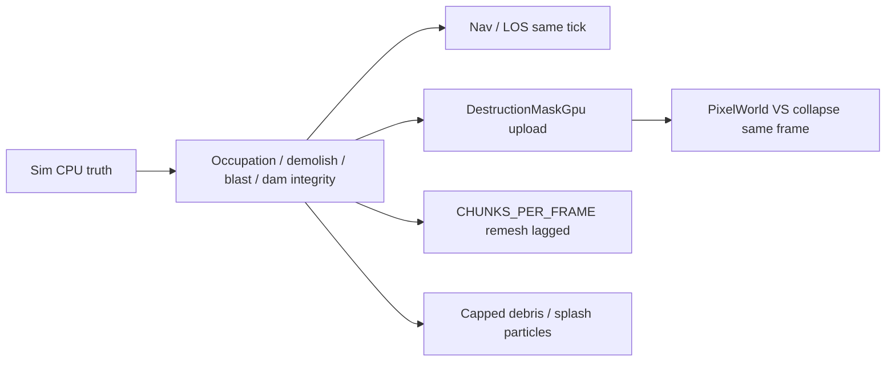

# PLAN-DESTROY-PRESENTATION-v1 — destruction look without sim lag

| Field | Value |
|:---|:---|
| **Id** | **PLAN-DESTROY-PRESENTATION-v1** |
| **Status** | **ACTIVE** — program charter (docs + slice queue) |
| **Date** | 2026-11-17 |
| **First slice** | [`plan_destroy_t2_mask_v1.md`](plan_destroy_t2_mask_v1.md) (**DESTROY-T2-MASK-v1**) |
| **Parents** | [`plan_final_gpu_presentation_v1.md`](plan_final_gpu_presentation_v1.md) · [`plan_gpu_stubs_kill_v1.md`](plan_gpu_stubs_kill_v1.md) · [`plan_dam_flood_benchmark_v1.md`](plan_dam_flood_benchmark_v1.md) · [`plan_voxel_occupation_v1.md`](plan_voxel_occupation_v1.md) · [`design_gpu_rtt_bake_water_displace_v1.md`](design_gpu_rtt_bake_water_displace_v1.md) |
| **Book rows** | **PHYS-08** (destructible / construction funnel) · **PCG-06** (grammar → voxels) · **RND-02** (cull; portals DEFER) · presentation only for mask |

## Problem

War-sim destruction stresses three systems at once:

1. **Sim** — occupation, nav, integrity must update atomically on the CPU tick.
2. **Look** — players must not see units on air or shoot through ghost walls while PixelWorld remeshes (`CHUNKS_PER_FRAME=48`).
3. **Perf** — 50 simultaneous collapses must not stall staging / bake uploads.

Chat reviews (mask, staging ring, grammar roles, fire/water forces) lived only in conversation until this program. Draft “DESTROY-T2” paths that assumed `src/simulation/` and a fictional `pixel_world.wgsl` + `voxel_coord` attribute are **rejected**; see the T2 charter for corrected wiring.

## Authority (non-negotiable)



| Rule | Meaning |
|:---|:---|
| Sim never waits on remesh or bake | Graphics lag is presentation debt only |
| GPU mask is a **consumer** | Downstream of CPU occupation clears — not a second sim writer; not save authority |
| Water / fire stay decoupled | Field solvers + scorch companion (GPU-B); **never** bake floods/fire into land RGBA |
| Grammar authors voxels + roles | PCG-06 / massing → occupation tags; polygons are not destruction truth |

## Four-tier destruction (look pipeline)

| Tier | Name | Owner | Notes |
|:---:|:---|:---|:---|
| **1** | Atomic sim + nav | Construction funnel / fire / water | Already the product rule; PHYS-08 demolish/blast; dam `column_integrity` |
| **2** | Same-frame GPU discard | **DESTROY-T2** | Mask upload + VS collapse — **first implement** |
| **3** | Catch-up remesh | PixelWorld `MeshBuf` | Keep main-thread budget; priority drain = T2b; task-pool remesh DEFER |
| **4** | Sensory cover | Particles | Capped GPU bursts; not rigid-body rubble |

## Sequenced slices

| ID | Slice | Exit | Status |
|:---|:---|:---|:---|
| **DESTROY-T2** | Same-frame mask + PixelWorld ground collapse | Destroy tick → geometry gone same frame; remesh may lag | **ADOPTED** — [`plan_destroy_t2_mask_v1.md`](plan_destroy_t2_mask_v1.md) |
| **DESTROY-T2.1** | Massing / site columns sample same mask | Buildings vanish with ground | **ADOPTED** — `layers.rs` `build_site` filters `MASK_DESTROYED` |
| **DESTROY-T2b** | Priority remesh for masked chunks | On-screen destroyed chunks drain first in `pending` | **ADOPTED** — `remesh_priority` → pending front |
| **STAGE-RING** | Tiered control/field upload ring (mask always Tier 0) | Battle-tick dirty storm does not stall | **ADOPTED** Tier 0 — [`plan_stage_ring_v1.md`](plan_stage_ring_v1.md); Tier 2+ PLANNED |
| **STRUCT-ROLE** | Grammar/occupation `StructuralRole` tags | Glass ≠ load column | **ADOPTED** — [`plan_struct_role_v1.md`](plan_struct_role_v1.md) · dam writer |
| **STRUCT-CASCADE** | Per-building integrity / DSU (dam pattern generalized) | No floating island for tagged buildings | **ADOPTED** — [`plan_struct_cascade_v1.md`](plan_struct_cascade_v1.md) mask cascade |
| **DISASTER-PROXY** | Hydro/fire → integrity proxy via construction funnel | Surge/fire can demolish tagged structure | **ADOPTED** — [`plan_disaster_proxy_v1.md`](plan_disaster_proxy_v1.md) |
| **DEBRIS-FX** | Material-tinted GPU particle burst on collapse | Cover remesh lag | **ADOPTED** — [`plan_debris_fx_v1.md`](plan_debris_fx_v1.md) |

## Pillars captured from review (mapped)

| Pillar | Intent | Program home |
|:---|:---|:---|
| Instant GPU voxel masking | Presence ≠ material bake/remesh | **DESTROY-T2** |
| Time-sliced staging ring | On-frustum first; off-screen 2–4 frames | **STAGE-RING** |
| Decoupled fluid/fire/wind VRAM | Water field + scorch + particles | Already GPU-D / GPU-B / particle spines — **enforce, don’t re-bake** |
| Grammar → voxel + structural tags | Load vs facade for cascade | **STRUCT-ROLE** → **STRUCT-CASCADE** |
| Fire/water as sim forces | Extinguish, flood demolish, heat decay | **DISASTER-PROXY** (cheap proxies; see DEFER) |

## Explicit DEFER

| Topic | Why |
|:---|:---|
| PVS / portals | Top-down + destruction; cost > benefit (RND-02) |
| Mesh shaders / meshlets | Not Bevy 0.20 production path |
| tokio / task-pool remesh as prerequisite | Determinism + `Assets<Mesh>` races; time-sliced remesh OK once mask works |
| Full \(½ρv²\) hydro force field | Prefer later `depth × speed²` (or momentum) vs integrity |
| Unit SDF / local voxel damage shells | Separate vehicle program |
| Rigid-body tumbling debris | GPU particles + CPU rubble occupancy only |
| Screen-space heat distortion as Accept | Polish only |

## Related live code (do not reinvent)

| Domain | Anchor |
|:---|:---|
| Demolish / blast | `src/construction/demolish.rs`, `src/construction/blast.rs` |
| Dam integrity | `src/construction/dam_barrier.rs` |
| Occupation | `VoxelOccupationBook` (strategic / construction funnel) |
| PixelWorld remesh | `src/render/pixel_world/terrain.rs` (`CHUNKS_PER_FRAME`) |
| Water GPU | `publish_surface_water_gpu_field` + `water_field_3d.wgsl` |
| Scorch | `TerrainScorchField` (GPU-B) |
| Fire ↔ water | `SurfaceWaterFireGate` |

## Protocol

```text
ORIENT  parents + DESTROY-T2 charter
DO      one slice at a time; T2 first
ACCEPT  production caller file:line — never include_str-only ADOPTED
EXIT    ADOPTED | UNWIRED | BLOCKED
```

## Next

Destruction core **ADOPTED**. Residual: playcheck eye · veg GPU instance buffer · RND-12 dispatch_indirect · mip bleed · GS-06/08.
